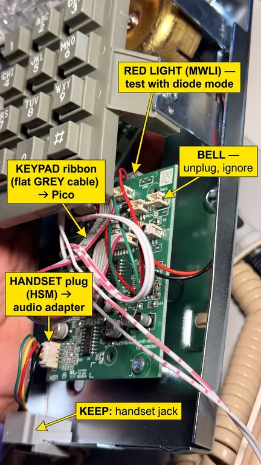
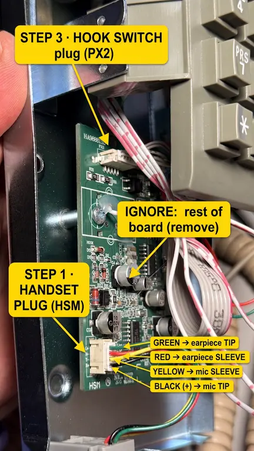
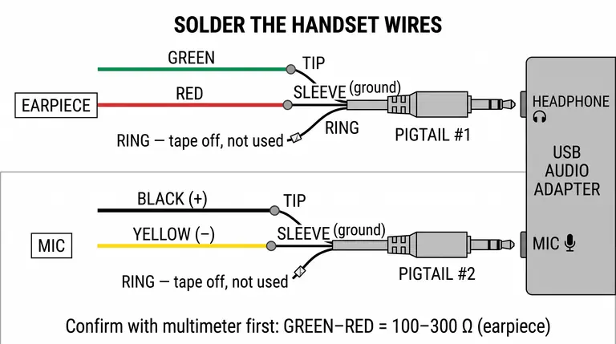

# Wiring the HA9888 wall phone, step by step

For the beige wall phone (board printed **HA9888TSD**). The same steps apply to every unit.
The images were made with fal (Nano Banana 2.1 Edit) from photos of the real board, then checked against the board.
**Wherever an image and this text disagree, trust the text and the multimeter.**

You need: a multimeter, the soldering iron, the two 3.5mm pigtails, the Sabrent USB audio adapter, heat-shrink, tape and a marker.
The phone is **not** plugged into anything during this work.

---

## Step 1: Identify everything

| Plug on the board | What it is | Action |
|---|---|---|
| **HSM** (white 4-pin, lower left) | Handset jack | **Keep.** It goes to the audio adapter. |
| **Gray flat ribbon** (red edge stripe) | Keypad | **Keep.** It goes to the Pico. |
| **PX2** (top left, next to the "HOOK" print) | Hook switch | **Keep.** It goes to the Pico. |
| **MWLI** (2-pin, top) | Red light | Test it in step 5. |
| **BELL** (two 2-pin plugs) | Mechanical bell | Unplug and ignore. |
| Line jack wires (back plate) | Phone line | Unplug and ignore. |

1. Put a piece of tape on each cable and write its name: HANDSET, KEYPAD, HOOK, LIGHT, BELL, LINE.
2. Photograph the board once more.
3. Unplug every connector. Remove the board's 2 screws. Bag and label the board (keep it, don't throw it away).

---

## Step 2: Handset plug (HSM)

The board labels the 4 handset wires **G+ R− Y− B+**:

| Wire | Element |
|---|---|
| **Green + Red** | Earpiece |
| **Black (+) + Yellow (−)** | Mic |

**Confirm with the meter before cutting anything.** Plug the handset into its jack. Then, on the white HSM plug:
- Set the meter to **Ω, 2k range**. Measure **green to red**. You should read **about 100–300 Ω**. ✅ That's the earpiece.
- Measure **black to yellow** once, then again with the probes swapped. If the two readings are **different**, it's an electret mic. ✅
- If green to red does *not* read 100–300 Ω, stop and send a photo of the readings.

---

## Step 3: Solder the handset to the pigtails

1. Cut the white HSM plug off, about 1 cm from the plug. Strip 5 mm from each of the 4 wires.
2. On each 3.5mm pigtail, find which bare wire is **tip**, **ring** and **sleeve**. Use the meter's continuity beep between each wire and the metal parts of the plug: **tip** = the very end, **ring** = the middle band, **sleeve** = the long part nearest the cable.
3. Slide heat-shrink onto each wire first, then solder:

| Pigtail | Handset wire | → Pigtail wire |
|---|---|---|
| **#1 → adapter's 🎧 HEADPHONE jack** | **Green** | **Tip** |
| | **Red** | **Sleeve** |
| | — | Ring: tape it off, don't connect it |
| **#2 → adapter's 🎤 MIC jack** | **Black (+)** | **Tip** |
| | **Yellow (−)** | **Sleeve** |
| | — | Ring: tape it off, don't connect it |

4. Shrink the tubing. Label the pigtails **EAR** and **MIC** with tape.
5. **Test:** plug the adapter into a laptop. Record a voice memo by talking into the handset, then play it back through the earpiece.
   - Mic silent? Swap black and yellow.
   - Earpiece silent? Re-check the green and red joints.

---

## Step 4: Hook switch (PX2)

1. Set the meter to **continuity (beep)**.
2. Probe pairs of contacts in the PX2 plug while pressing and releasing the hook lever. A sewing pin taped to the probe reaches inside the plug.
3. Find the pair that **beeps in one position only**. Write down:
   - which two contacts (count from one end of the plug), and
   - whether it beeps with the lever **up** (handset lifted) or **down** (hung up).

Those 2 wires go to the Pico: one to **GP15** (pin 20), the other to **GND** (pin 18).

---

## Step 5: Keypad (gray ribbon) and red light (MWLI)

**Keypad.** Number the ribbon wires from the **red-striped edge** (1 = red stripe). On continuity, hold each key and find the 2 wires that beep:

| Key | Wires that beep |
|---|---|
| 1 | _ and _ |
| 2 | _ and _ |
| 3 | _ and _ |
| 4 | _ and _ |
| 7 | _ and _ |
| \* | _ and _ |
| # | _ and _ |

**Red light.** Set the meter to **diode mode** and probe the light's 2 wires, then swap the probes. If it glows faintly, or reads about 1.6–2.0 V one way, it's an LED and the Pico can blink it.

Send the step 4 and step 5 results back. The Pico pin map in `pico/code.py` gets set to match, and steps 6–7 (wiring the Pico) get written for this exact phone.
